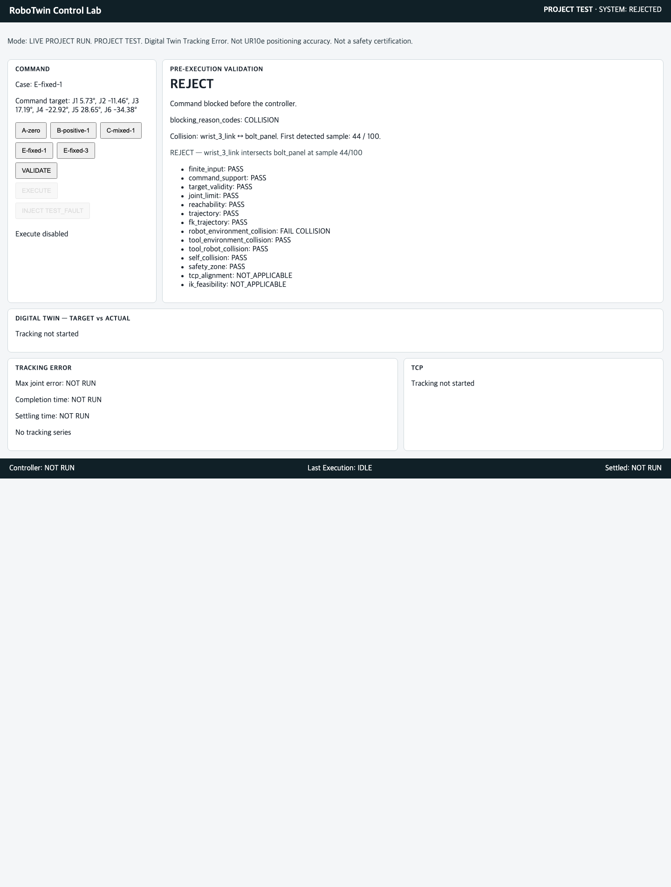
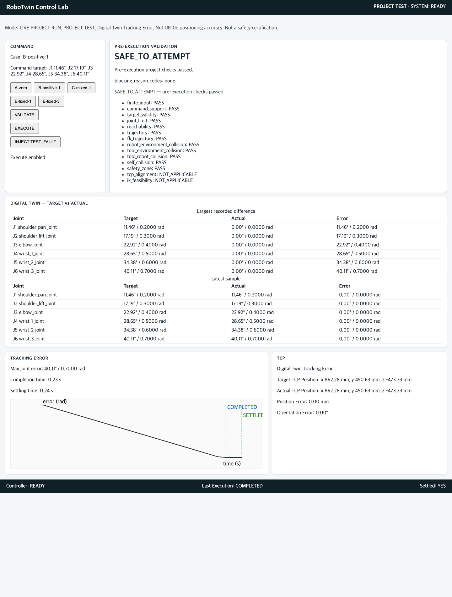
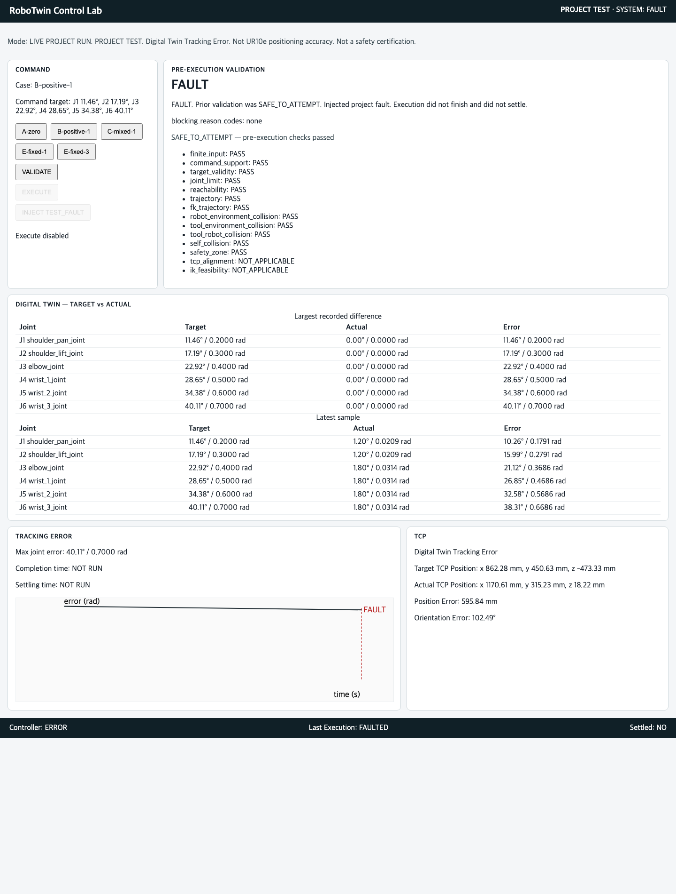

# RoboTwin Control Lab

산업용 로봇 명령을 실제 Controller로 전달하기 전에 Digital Twin에서 작업 가능성과 충돌을 검증하고, 승인된 명령만 실행하며, 실행 중 Target과 Actual 상태를 추적해 오차와 수렴 상태를 검증하는 로봇 제어·검증 플랫폼입니다.

RoboTwin Control Lab checks whether an industrial robot command can be attempted, including collision, in a digital twin before that command reaches a controller. Only an approved command is executed. During execution the platform tracks target and actual state and checks error and settling.

```text
Pre-Execution Validation
+
Controller Abstraction
+
Digital Twin Tracking
+
Operator HMI
+
Reliability Evidence
```

Industrial Robot Digital Twin. Control Validation. Software Integration.

이 저장소의 현재 기준선은 P-011 FINAL PASS `cd39c3c237a504c2ee56fbe40a94cb1fed4d9ab7`이다. 범위는 Employment-ready MVP baseline이다. P-012 RL/Imitation과 P-013 Domain Randomization은 시작하지 않았다.

## What Problem Does It Solve?

기술 목록보다 먼저, 명령 하나에 대한 질문이다.

```text
Robot command
    ↓
Can this command be attempted?
    ↓
Could it collide?
    ↓
Should the controller receive it?
    ↓
Did actual state follow target?
    ↓
Did the system converge?
```

`SAFE_TO_ATTEMPT`는 실행 전 검사가 통과했다는 PROJECT TEST 판정이다. 체결 성공도, 산업 안전 인증도 아니다.

## System Architecture

정본 계약은 [`docs/ARCHITECTURE.md`](docs/ARCHITECTURE.md)다. 이 README의 그림은 그 계약을 바꾸지 않는 면접용 요약이다. 구현된 범위는 [`docs/PORTFOLIO_ARCHITECTURE.md`](docs/PORTFOLIO_ARCHITECTURE.md)에 따로 적었다.

```text
                 RoboTwin Control Lab

                     RobotCommand
                          │
                          ▼
                ┌──────────────────┐
                │ Pre-Execution    │
                │ Validator        │
                └────────┬─────────┘
                         │
              ┌──────────┴──────────┐
              │                     │
            REJECT            SAFE_TO_ATTEMPT
              │                     │
              X                     ▼
                              ┌─────────────┐
                              │ Controller  │
                              │ Abstraction │
                              └──────┬──────┘
                                     │
                         ┌───────────┴──────────┐
                         │                      │
                       Target                 Actual
                         │                      │
                         └───────────┬──────────┘
                                     ▼
                              ┌─────────────┐
                              │ Digital     │
                              │ Twin Monitor│
                              └──────┬──────┘
                                     │
                            Joint / TCP Error
                            Settling / Fault
                                     │
                                     ▼
                              ┌─────────────┐
                              │ Operator HMI│
                              └─────────────┘
```

Controller 쪽에서 실제로 연결된 범위는 다음이다. Unity와 Isaac Sim은 같은 nominal UR10e를 독립적으로 검증하는 simulator이며, controller backend가 아니다.

```text
                 IRobotController
                       │
          ┌────────────┴────────────┐
          │                         │
    Virtual PMAC              ROS 2 Adapter
    motion backend            transport only
                                    │
                                    ▼
                              Virtual PMAC
```

Golden Reference Robot은 official nominal UR10e다. 실제 UR10e hardware validation이 아니다. 출처는 `UniversalRobots/Universal_Robots_ROS2_Description`의 `ur_description` 3.6.0, `ur_type=ur10e`이고, 핀은 commit `7ce98d8c3512b9d0239da93b75de68ea64f61bd6`이다. 기록은 [`robot_description/SOURCE_MANIFEST.md`](robot_description/SOURCE_MANIFEST.md)다.

## 2-Minute Demo

대표 화면은 REJECT다. 이 프로젝트의 차이는 simulator 화면이 아니라, 충돌 명령을 controller에 넣지 않는 것이다.

### Demo B — REJECT

`E-fixed-1`은 검증에서 `REJECT` / `COLLISION`이다. 접촉은 `wrist_3_link`와 `bolt_panel`이고 sample 44/100이다. Controller는 호출되지 않는다.

```text
E-fixed-1
↓
Validate
↓
COLLISION
wrist_3_link ↔ bolt_panel
↓
REJECT
↓
Controller NOT CALLED
```



### Demo A — SAFE

`B-positive-1`은 `SAFE_TO_ATTEMPT` 뒤 controller로 전달된다. 이동 중 Target과 Actual은 다르고, 끝난 뒤 `COMPLETED`와 `SETTLED`가 구분된다.

```text
B-positive-1
↓
Validate
↓
SAFE_TO_ATTEMPT
↓
Controller
↓
Target != Actual
↓
Convergence
↓
COMPLETED
↓
SETTLED
```



### Demo C — FAULT

실행 중 `TEST_FAULT`가 주입되면 `ERROR` / `FAULTED`다. 그 실행은 `COMPLETED`도 `SETTLED`도 아니다. Reset 뒤 joint state는 유지되고, 다음 명령은 완료된다.

```text
Execution
↓
TEST_FAULT
↓
ERROR / FAULTED
↓
Not Completed
↓
Not Settled
↓
Reset
↓
Joint State Preserved
↓
Next Execution Succeeds
```



세 화면의 기록은 [`evidence/P-010/summary.md`](evidence/P-010/summary.md)다.

## Key Results

대표 수치만 둔다. 자리수는 읽기 위한 반올림이고, 원값은 링크한 evidence에 있다.

| Result | Value | Scope | Source |
| --- | --- | --- | --- |
| Unity ↔ Isaac TCP position | 0.291 mm | Cross-sim PROJECT TEST. Real robot accuracy가 아니다. | [`evidence/P-004/fix-attempt2/summary.md`](evidence/P-004/fix-attempt2/summary.md) `0.29056228373221366 mm` |
| ROS 2 transport latency P95 | 1.09 ms | Project test transport latency. Hard real-time latency가 아니다. | [`evidence/P-007/timing_results.json`](evidence/P-007/timing_results.json) `p95_ms` `1.0901190034928732` |
| Reliability | 500 / 500 | 500-cycle deterministic project workload | [`evidence/P-011/summary.md`](evidence/P-011/summary.md) |
| Unsafe submissions | 0 | REJECT 명령이 controller에 들어간 횟수 | 같은 P-011 기록 |
| Collision reject consistency | 100 / 100 | `E-fixed-1` | 같은 P-011 기록 |
| Fault recovery | 10 / 10 | Primary 500과 별도 | 같은 P-011 기록 |
| Timeout / non-finite | 0 / 0 | 같은 workload | 같은 P-011 기록 |

## Safety / Validation Gate

Validator는 joint limit, collision, trajectory, safety zone을 포함한 실행 전 검사를 한다. `REJECT`이면 controller submit이 없다.

`E-fixed-1` 100회는 모두 `REJECT`, `COLLISION`, `controller_submitted = false`, `tracking_started = false`였다. 한 번이라도 controller에 들어가면 P-011은 FAIL이다. 측정값은 0이다.

## Digital Twin Tracking

승인된 명령만 monitor가 tracking을 시작한다. Non-zero safe case에는 Target과 Actual이 다른 intermediate sample이 있다. `COMPLETED`와 `SETTLED`는 같은 표시가 아니다. Fault 실행은 둘 다 아니다.

P-009가 기록한 이동 중 peak TCP position difference는 `667.340659995662 mm`다. 이것은 수렴 후 위치 오차가 아니다. P-011 safe 400건의 final joint error는 `0.0 rad`다. 시간은 project clock의 execution / settling이며, P-007 ROS transport latency와 섞지 않는다.

기록: [`evidence/P-009/summary.md`](evidence/P-009/summary.md), [`evidence/P-011/summary.md`](evidence/P-011/summary.md).

## Reliability

P-011은 같은 `VirtualPmacController` session에서 다섯 case를 교차로 100회, 총 500 cycle 실행했다.

```text
500/500 correct
400/400 SAFE executions
100/100 collision rejects
0 unsafe submissions
10/10 fault recoveries
```

표시 범위는 **500-cycle deterministic project workload**다. Field reliability, MTBF, production availability가 아니다.

## Engineering Failures & Fixes

테스트를 통과시키기 위해 안전 검증 기준을 낮추지 않았다. 예상과 다른 결과는 독립적으로 확인한 뒤, 틀린 가정을 수정했다.

### Isaac Tool0

P-003에서 Tool0가 물리적으로 불가능한 궤적으로 떨어졌다. `RigidPrim` 관찰이 없는 `RigidBodyAPI`를 만들어 scene semantics를 바꿨다. Pose는 `UsdGeom.XformCache`로 읽도록 바꿨고, Tool0 궤적은 articulation 범위 안으로 돌아왔다.

기록: [`evidence/P-003/fix-attempt1/summary.md`](evidence/P-003/fix-attempt1/summary.md), [`evidence/P-003/fix-attempt1/diagnostics.md`](evidence/P-003/fix-attempt1/diagnostics.md).

### Cross-Sim Error

P-004 첫 비교에서 Unity ↔ Isaac TCP position difference는 `3.1548989314166063 mm`였다. Articulation root를 고친 뒤에도 `1.2526456740680483 mm`가 남았고, 그 나머지는 gravity 아래 shoulder PD equilibrium이었다. Root 수정과 Isaac drive stiffness `100000` → `200000 Nm/rad` 이후 대표값은 `0.29056228373221366 mm`다. Empirical TCP offset과 tolerance 완화는 쓰지 않았다.

기록: [`evidence/P-004/summary.md`](evidence/P-004/summary.md), [`evidence/P-004/fix-attempt1/summary.md`](evidence/P-004/fix-attempt1/summary.md), [`evidence/P-004/fix-attempt2/summary.md`](evidence/P-004/fix-attempt2/summary.md).

### E-fixed-1 Collision

처음 acceptance는 canonical configuration 5개가 모두 `SAFE_TO_ATTEMPT`라고 가정했다. 실제 `E-fixed-1`은 `REJECT`였다. Collision rule을 느슨하게 만들지 않았다. 독립 검사 결과는 `TRUE_COLLISION`, `wrist_3_link` ↔ `bolt_panel`이다.

```text
Validator defect: NO
Acceptance assumption defect: YES
```

그 판정은 이후 경로에 그대로 남았다.

```text
P-008  TRUE_COLLISION confirmed
        ↓
P-010  Execute blocked
        ↓
P-011  100 / 100 REJECT
        ↓
Unsafe submission = 0
```

기록: [`evidence/P-008/summary.md`](evidence/P-008/summary.md), [`evidence/P-008-FIX1/summary.md`](evidence/P-008-FIX1/summary.md), [`evidence/P-008-FIX2/summary.md`](evidence/P-008-FIX2/summary.md).

## Technology

이름을 나열하는 대신, 이 저장소에서 맡은 역할만 적는다.

```text
Python
- canonical robot API
- independent FK
- validation
- controller abstraction
- evidence automation

ROS 2 Jazzy
- command / state transport
- target / actual separation

Unity
- UR10e articulation validation

Isaac Sim
- independent simulation validation

USD
- workcell / robot scene representation
```

Motion backend에 적힌 이름은 Virtual PMAC와 PMAC-compatible controller semantics다. Power PMAC Controller 구현 완료가 아니다.

## Evidence

| Gate | Purpose | Final result | Record |
| --- | --- | --- | --- |
| P-001 | Golden Reference / FK | PASS | [`evidence/P-001B/summary.md`](evidence/P-001B/summary.md) |
| P-002 | Unity | PASS | [`evidence/P-002/summary.md`](evidence/P-002/summary.md) |
| P-003 | Isaac | PASS | [`evidence/P-003/fix-attempt1/summary.md`](evidence/P-003/fix-attempt1/summary.md) |
| P-004 | Cross-Sim | PASS | [`evidence/P-004/fix-attempt2/summary.md`](evidence/P-004/fix-attempt2/summary.md) |
| P-005 | Workcell | PASS | [`evidence/P-005/summary.md`](evidence/P-005/summary.md) |
| P-006 | Controller | PASS | [`evidence/P-006/summary.md`](evidence/P-006/summary.md) |
| P-007 | ROS 2 | PASS | [`evidence/P-007/summary.md`](evidence/P-007/summary.md) |
| P-008 | Pre-Execution Validation | PASS | [`evidence/P-008-FIX2/summary.md`](evidence/P-008-FIX2/summary.md) |
| P-009 | Target vs Actual | PASS | [`evidence/P-009/summary.md`](evidence/P-009/summary.md) |
| P-010 | Operator HMI | PASS | [`evidence/P-010/summary.md`](evidence/P-010/summary.md) |
| P-011 | 500-Cycle Reliability | PASS | [`evidence/P-011/summary.md`](evidence/P-011/summary.md) |

P-000 요구사항과 구조 계약은 [`docs/REQUIREMENTS.md`](docs/REQUIREMENTS.md), [`docs/ARCHITECTURE.md`](docs/ARCHITECTURE.md)에 있다. 이 문서는 그 문장을 개정하지 않는다.

자세히 볼 기록:

- [`evidence/P-004`](evidence/P-004)
- [`evidence/P-008`](evidence/P-008)
- [`evidence/P-009`](evidence/P-009)
- [`evidence/P-010`](evidence/P-010)
- [`evidence/P-011`](evidence/P-011)

면접 직전 요약은 [`docs/PORTFOLIO_BRIEF.md`](docs/PORTFOLIO_BRIEF.md)다.

이 저장소가 보여주는 작업은 Robot Software Architecture, Controller Abstraction, Kinematics, Simulation Integration, ROS 2 Integration, Pre-Execution Validation, Failure Investigation, Reliability Engineering이다.

## Limitations

```text
No real robot validation

No real Power PMAC validation

No industrial safety certification

UR10e model is nominal reference

Tracking metrics are project virtual-controller results

500-cycle result is deterministic project workload,
not field reliability or MTBF evidence
```

NOT VERIFIED AGAINST REAL POWER PMAC.

`SAFE_TO_ATTEMPT`는 certified safety가 아니다. P-007 latency는 hard real-time certification이 아니다.

## How to Reproduce

호스트에서 의존성 파일은 없다. 기록된 호스트 검사는 Python 3.14.4와 pytest로 실행했다. Isaac Sim, Unity, ROS 2는 이 명령에 포함되지 않는다.

```bash
PYTHONPATH=. python3 -m pytest tests/unit/test_p006_controller.py tests/unit/test_p008_validator.py tests/unit/test_p009_monitor.py tests/unit/test_p010_hmi.py tests/unit/test_p011_reliability.py -q
```

기록된 결과는 [`evidence/P-011/test_results.txt`](evidence/P-011/test_results.txt)의 `44 passed in 21.94s`다.

Operator HMI는 다음 프로세스다. 주소는 `127.0.0.1:8765`다. 위에 넣은 세 장은 그 화면의 기록이다.

```bash
PYTHONPATH=. python3 -m hmi.server
```

500-cycle 생성기는 `PYTHONPATH=. python3 -m reliability.evidence`다. 이 명령은 `evidence/P-011`을 다시 쓴다. 커밋된 primary wall runtime은 `1054.1445243339986 s`다.

ROS 2 측정 환경은 [`evidence/P-007/environment.md`](evidence/P-007/environment.md)다. Ubuntu 24.04, Python 3.12.3, ROS 2 Jazzy. Cross-sim 환경은 [`evidence/P-004/fix-attempt2/environment.md`](evidence/P-004/fix-attempt2/environment.md)다. Unity `2022.3.62f2`, Isaac Sim `6.2.0-rc.14`. 이 packaging은 그 환경을 다시 실행하지 않았고, 과거 evidence를 다시 생성하지 않는다.
